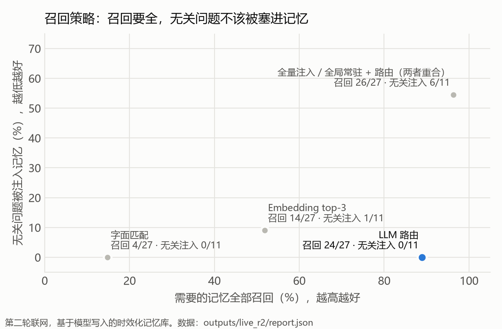
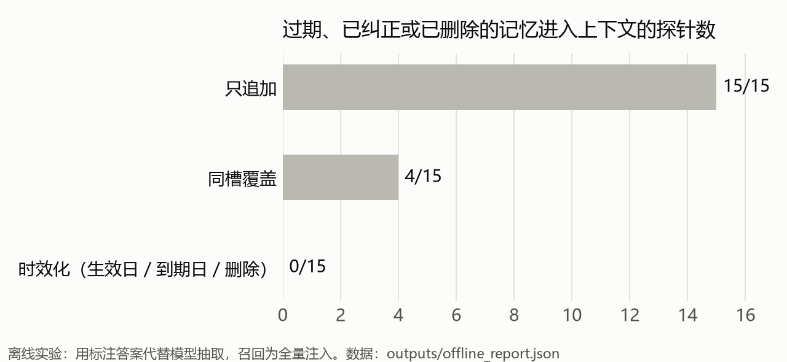
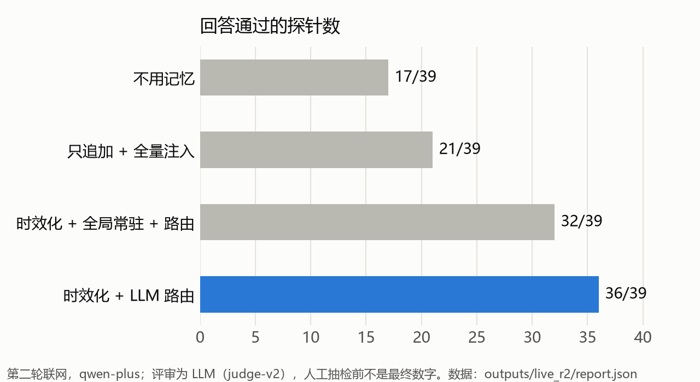

# assistant-memory-eval

**个人助理的长期记忆：记什么、怎么更新、什么时候拿出来用。**

用自建的 24 个跨会话场景，对比记忆的更新策略和召回策略，并逐条归因失败样本。目标是让用户觉得「它懂我」，而不是「它记错了」，或者「它怎么老提这个」。

> 个人项目。场景全部虚构，模型为 qwen-plus。数字来自小规模自建评测，第二轮不是盲测，详见文末「边界」。

## 关键发现

1. **时效性主要靠更新策略，不靠模型。** 只追加时，过期、已纠正或已删除的记忆在 15/15 个相关探针里进入上下文；给每条记忆加生效日、到期日和删除标记后，降到 **0/15**。
2. **召回的难点在于不该用的时候别用。** 全量注入让 11 个无关问题里的 6 个被塞进了记忆；改用 LLM 按问题路由后降到 **0/11**，同时召回 24/27，回答通过率从 21/39 升到 **36/39**。
3. **模型拿到个人信息就倾向于用上。** 让记忆「全局常驻」后，模型在 React 报错里问候用户的猫，在电影推荐里提醒高血压。抽取 prompt 已经限定了 global 的范围，模型仍把 31 条记忆中的 28 条标成了 global。所以什么该常驻，应该由程序决定。
4. **评审本身也要被评测。** 首版 LLM 评审看不到注入了哪些记忆，把正确使用记忆的回答判成编造；改进后仍有误判。人工抽检一致率：**待补**。



每条结论背后的失败样本，见 **[docs/CASES.md](docs/CASES.md)**。

## 评测怎么设计

`data/memory_benchmark.json`（由 `build_benchmark.py` 生成）：24 个场景、40 轮会话、39 个探针问题。

| 维度 | 测什么 | 例子 |
|---|---|---|
| 准确性 | 记对、不张冠李戴、不把一次性信息当偏好 | 「同事小王芒果过敏」不能变成用户本人过敏 |
| 时效性 | 更新覆盖、未来生效、临时状态到期 | 「10 月 1 号起调到上海」，9 月 25 号问时仍按杭州 |
| 召回相关性 | 需要的记忆召回、无关的不注入 | 「明天要不要带雨衣」需要想到「骑电动车上班」 |
| 应用效果 | 回答真正用上了记忆 | 「这套房合适吗，月租 4800」要指出超出预算 |
| 遗忘与隐私 | 删除请求、敏感信息不入库 | 用户说「把我生日删掉」，之后不能再说出来 |

- **每个探针**标注应该用到的记忆、不能用的记忆（已过期、已纠正、已删除），以及是否完全不该用记忆。11 个探针刻意不需要记忆，专门测「硬扯」。
- **两层打分：**
  - 上下文层：注入的记忆有没有覆盖该用的、有没有混入不能用的。由程序对照标注自动打分。
  - 回答层：LLM 评审按三项判断：用上了该用的、没依赖不能用的、没有编造或硬扯个人信息。然后抽 20% 人工复核。
- **实验纪律：** Embedding 阈值（0.35）在运行前固定；评审改版后只换评审重判，不重新生成回答；评分口径没有为结果事后修改。例如 M07 的评分假阴性保留原样，在下文说明。

## 策略与结果

**更新策略**（`memlab/store.py`）：只追加、同槽覆盖、时效化（生效日 / 到期日 / 删除，保留历史）。



同槽覆盖仍漏 4 条：「下月起生效」被提前生效，出差结束后临时状态不失效。离线实验用标注答案代替模型抽取，所以这里只比较存储策略本身。

**召回策略**（`memlab/recall.py`）：全量注入、字面匹配（字符 bigram TF-IDF）、Embedding top-3、LLM 路由，以及第二轮新增的「全局常驻 + 路由」。下表来自第二轮联网，记忆库由模型抽取写入：

| 召回策略（时效化存储） | 需要的记忆全部召回 | 坏记忆泄漏 | 无关问题被注入 | 平均注入条数 |
|---|---:|---:|---:|---:|
| 全量注入 | 26/27 | 1/15 | 6/11 | 1.33 |
| 字面匹配 | 4/27 | 0/15 | 0/11 | 0.13 |
| Embedding top-3 | 14/27 | 0/15 | 1/11 | 0.51 |
| **LLM 路由** | **24/27** | 1/15 | **0/11** | 0.74 |
| 全局常驻 + 路由 | 26/27 | 1/15 | 6/11 | 1.31 |

对照：只追加 + 全量注入时，坏记忆泄漏 15/15。

**回答效果**（第二轮，judge-v2 评审，人工抽检前不是最终数字）：



## 迭代过程

**第一轮**（extract-v1 + judge-v1，`outputs/live/`）

- **抽取：** 应写入的 42 条信息都写入了，敏感信息 0 入库。但逐条读样本发现三处时间错误，分两类：
  - 临时状态覆盖了常住地，到期后常住地一起消失（M03 出差、M10 回国）；
  - 事件日期被当成生效日期，出发前查不到旅行计划（M16）。

  「有没有写入」这个指标查不出这类错误。
- **召回：** LLM 路由最好，召回 21/27、无关注入 0/11。它漏掉的有两种：库里有、但路由判断用不上的语言偏好（M19）；以及因为抽取错误、回答时已经失效的记忆。
- **评审：** v1 看不到注入的记忆，「时间感知 + 路由」被判失败的 9 条中约 6 条是误判，这一轮的通过率不作为结论。

**改动**

- **extract-v2：** 区分「从某天起成立的事实」和「某天发生的事件」；临时状态单独存一条；每条记忆标 global / topical。
- **judge-v2：** 把注入的记忆和「旧值被什么替换」一起交给评审。先用 `rejudge.py` 只换评审、重判第一轮的回答，v1 和 v2 的判定一致率为 32–33/39。
- **best_global：** global 记忆常驻，其余按需路由，用来补路由漏掉的全局偏好。

**第二轮**（extract-v2 + judge-v2，`outputs/live_r2/`）

- 三处抽取错误都修复了。应写入命中显示 41/42，差的 1 条（M07）内容正确，是评分关键词没匹配上，评分规则没有事后修改。
- LLM 路由召回 24/27、无关注入 0/11，回答通过率 36/39。
- best_global 反而降到 32/39：28/31 条记忆被标成 global，常驻几乎等于全量注入（发现 3）。

## 下一步

- **常驻白名单：** 由程序固定注入回答语言、称呼、时区，其余一律按需路由。要用新写的场景验证，不能在这 24 个场景上调。
- **盲测：** 请别人另写一批场景，冻结后再跑，检验 extract-v2 和路由能否泛化。
- **稳定性：** 同一配置重复运行，看结论是否变化。
- **评审：** 评分要点写明信息类别（见 CASES 第 7 条）；完成人工抽检，报告一致率。
- **产品对照：** 在真实助手产品上手测同类场景。

## 复现

Python 3.11+。

```bash
pip install -r requirements.txt
python -m pytest tests -q                           # 离线测试，不调模型
python run_offline.py                               # 离线实验 -> outputs/offline_report.md
python run_live.py --report --out outputs/live_r2   # 用已保存的结果重建第二轮报告，不发请求
python rejudge.py --report                          # 重建 judge-v2 重判报告，不发请求
pip install matplotlib && python scripts/make_charts.py   # 重画 README 里的图
```

联网实验需要在环境变量里设置 `DASHSCOPE_API_KEY`（阿里云百炼），会产生费用。完整一轮约 430 次生成请求和 230 条 Embedding 文本，有调用上限，可中断续跑，不会重复发送已记录的请求：

```bash
python run_live.py --approved-live --limit-scenarios 2 --out outputs/smoke   # 冒烟，约 30 次请求
python run_live.py --approved-live --out outputs/my_run
```

## 目录

```text
memlab/            存储策略、召回策略、指标、LLM 各步骤的 prompt 与解析
data/              评测集（build_benchmark.py 生成）
run_offline.py     离线实验：标注答案代替抽取，比较存储与字面召回
run_live.py        联网实验：抽取 -> Embedding -> 路由 -> 回答 -> 评审，结果可续跑
rejudge.py         只换评审、重判第一轮回答
outputs/live/      第一轮结果；rejudge_v2.* 和 human_review_v2.csv 为 judge-v2 重判
outputs/live_r2/   第二轮结果；human_review.csv 用于人工抽检
docs/CASES.md      失败样本与归因
scripts/           画图
tests/             离线测试（含用假模型跑通联网流水线、续跑不重复请求）
```

`outputs/*/state.json` 保存了全部模型输出和 Embedding 向量（各约 2.7 MB），用于不调模型就能重建报告。

## 边界

- 场景、标注和 prompt 出自同一作者，抽取规则和场景主题有重合，结果偏乐观。第二轮的 extract-v2、judge-v2 是看过第一轮失败样本后改的，用的也是同一批场景，**不是盲测**。
- 每个配置只跑一次，temperature 0，没有做显著性检验。39 个探针上差一两个不说明问题。
- 记忆和标注之间按关键词映射，属于近似匹配，可能误判（M07 就是一例）。
- LLM 评审有偏差，人工抽检尚未完成。
- 单用户、单次运行，没有并发、加密和权限控制，不是可部署的记忆系统。

来源与说明见 [NOTICE](NOTICE.md)。
